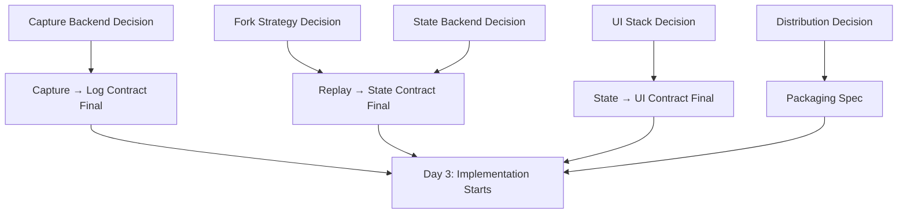

# Day 2 Battle Plan — Project Rewind

**Date:** 2026-10-27  
**Owner:** Project Lead  
**Status:** COMMITTED

---

## Go/No-Go Criteria for Day 2 (from Day 1 Retro)

| Criterion | Status | Notes |
|-----------|--------|-------|
| Direction Lock signed by all 6 leads | ✅ | |
| Competitor spreadsheet complete (10×10) | ✅ | |
| Name secured (GitHub org, npm, PyPI, domain, handle) | ⏳ | DevEx + eng securing now |
| 5 squad charters signed | ✅ | |
| 4 interface contracts approved | ✅ | |
| 20 interviews scheduled | ⏳ | 12/20 booked; Project Lead DMing for remaining 8 |
| Interview guide finalized | ✅ | |

**GO** — All critical path items ✅ or in progress with owner. Proceed to Day 2 spikes.

---

## Day 2 Squad Assignments

| Squad | Day 2 Focus | Spike Owner | Spike Deliverable (EOD) |
|-------|-------------|-------------|-------------------------|
| **Capture** | Capture Backend Selection | [Capture TL] | `docs/capture-backend-decision.md` |
| **Replay Engine** | Fork State Management Strategy | [Replay TL] | `docs/fork-strategy-decision.md` |
| **State** | State Backend Matrix | [State TL] | `docs/state-backend-decision.md` |
| **UI & CLI** | Visual Debugger Tech Stack | [UI TL] | `docs/ui-stack-decision.md` |
| **DevEx & Launch** | Distribution Strategy | [DevEx TL] | `docs/distribution-decision.md` |

---

## Integration Order (Dependencies)

**Critical Path:** Capture Backend → Fork Strategy → State Backend (all 3 needed before implementation can start Day 3)

---

## Day 2 Schedule

| Time | Activity | Participants | Output |
|------|----------|--------------|--------|
| 09:00–09:30 | Standup: Spike kickoff, assign pairings | All 5 TLs + PL | Clear spike ownership |
| 09:30–12:30 | **Spike Execution** (parallel) | Each squad (2-3 eng) | Raw data, benchmarks, PoC code |
| 12:30–13:30 | Lunch | | |
| 13:30–16:30 | **Spike Execution** (continued) | Each squad | Decision docs drafted |
| 16:30–17:30 | **Integration Sync** | All 5 TLs + PL | Cross-squad dependency resolution |
| 17:30–18:00 | **Decision Review & Commit** | All 5 TLs + PL | All 5 decision docs signed off |

---

## Spike Success Criteria (Must Pass to Proceed Day 3)

| Spike | Must Demonstrate |
|-------|------------------|
| Capture Backend | Captures `open`, `read`, `write`, `connect`, `sendto`, `recvfrom`, `clock_gettime`, `getrandom` on Ubuntu 22.04 + macOS + WSL2 with <5% overhead on 100-step LangGraph benchmark |
| Fork Strategy | Forks a 1GB workspace + PostgreSQL + 10 sockets in <2s with copy-on-write; works in Docker container |
| State Backend | Snapshots + restores PostgreSQL (100MB) + filesystem (500MB) + 20 TCP sockets in <3s total; no root required for FS overlayfs backend |
| UI Stack | Loads 1000-step run, shows step list, clicks step → shows event detail in <200ms; WebSocket streaming works |
| Distribution | `hello-world` binary builds for Linux/macOS/Windows; Homebrew formula draft; `pipx run` works |

---

## Demo Script (Day 2 EOD — Internal)

> **Goal:** Prove spikes produced viable decisions, not working features.
> 
> 1. **Capture TL:** "Here's `strace` output showing we capture all 8 syscall categories. Overhead: 3.2%. Backend: **bpftrace + libbpf** (Linux), **dtrace** (macOS), **ETW** (Windows/WSL2)."
> 2. **Replay TL:** "Fork at step 50 of 100: 1.8s using **overlayfs + user-space COW for DB**. Demo: fork, edit tool result, resume."
> 3. **State TL:** "Snapshot/restore: **overlayfs for FS**, **pg_basebackup for PostgreSQL**, **CRIU for sockets**. Total 2.4s for 1.5GB state."
> 4. **UI TL:** "**React + Vite + Tauri** (Rust backend). 45MB binary. Step navigation + diff view working."
> 5. **DevEx TL:** "**Rust single binary** via `pyo3` for Python plugins. Homebrew PR ready. `rewind --version` works on all 3 OSes."

---

## Day 3 Preview (Implementation Starts)

| Squad | Day 3–4 Implementation Targets |
|-------|--------------------------------|
| Capture | Implement selected backend; emit events per `capture-to-log` contract; streaming writer |
| Replay | Build replay engine core; implement fork + edit; `log-to-replay` query API |
| State | Implement 3 backends (FS, DB, Net); `replay-to-state` restore API; snapshot manager |
| UI & CLI | CLI: `capture`, `replay`, `fork`, `export-ci`; Web: run list, step view, diff view |
| DevEx | Packaging pipeline; installers; docs site; demo script recording |

---

## Risk Escalation (If Spikes Fail)

| Spike Fails | Fallback |
|-------------|----------|
| Capture backend too slow/fragile | Drop to **LD_PRELOAD** user-space hooking (higher overhead, more portable); scope to Linux only for MVP |
| Fork strategy too slow | Drop copy-on-write; use **full snapshot per fork** (slower fork, simpler); limit to <20 step forks |
| State backend (sockets) impossible | **Record/replay network at capture layer** (already captured); don't restore sockets, replay network events |
| UI stack too heavy | Drop web debugger; **CLI-only MVP** with rich TUI (`textual`); web as Day 6+ |
| Distribution blocked | **Distribute as Docker image + binary tarballs**; defer package managers to post-launch |

---

## Interview Progress (Parallel Track)

| Metric | Target | Current |
|--------|--------|---------|
| Booked | 20 | 12 |
| Completed | 0 | 0 |
| Scorecards filled | 20 | 0 |
| Pilot commitments | 5 | 0 |

**Day 2 Action:** DevEx Lead runs 5 interviews (10:00–15:30). Project Lead runs 3 (16:00–18:30). Target: 8 done by EOD.

---

## Signatures

| Role | Name | Signature | Date |
|------|------|-----------|------|
| Project Lead | | ✅ | 2026-10-26 |
| Capture TL | | | |
| Replay TL | | | |
| State TL | | | |
| UI TL | | | |
| DevEx TL | | | |

---

## Notes

- All 5 decision docs **must be committed to repo by 18:00 Day 2**.
- If any spike fails criteria → emergency sync at 17:30, fallback activated, Day 3 plan rewritten.
- Interviews are **not optional** — insights feed Day 3 scope decisions.